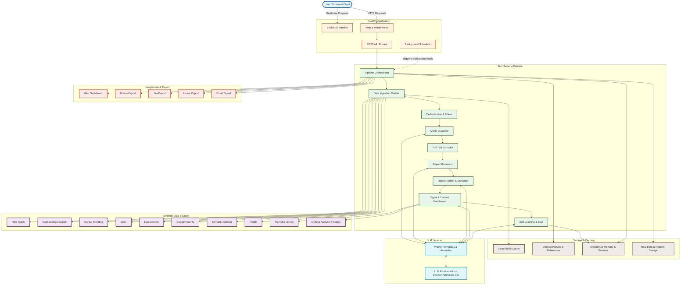
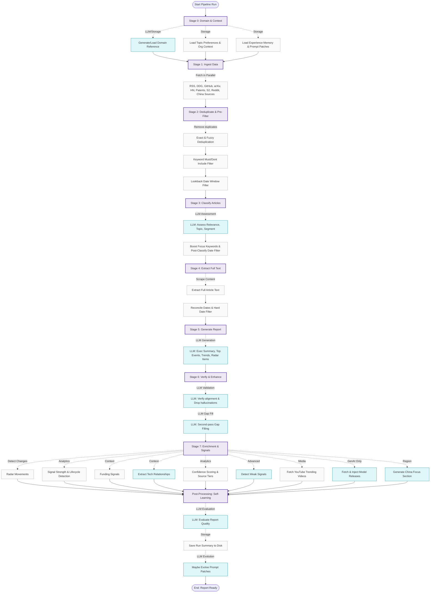

# Sensing Prompts Analysis

This document lists all the prompt generation blocks and prompt fragments found in `core/llm/prompts/sensing_prompts.py`.

## Prompt Fragments & Reusable Blocks

These functions generate specific textual blocks that are injected into larger prompts to enforce consistent rules across different tasks.

| Function Name | As-Is | Requires Modification| Description |
| :--- | :--- | :--- |:--- |
| **`_experience_memory_block`** | | | Combines experience memory, prompt patches, and feedback into a prompt block. |
| **`_custom_requirements_block`** | | |  Builds a high-priority custom requirements block to guide the LLM's analysis. |
| **`_stale_years_str`** | | | Returns a comma-separated list of years that are considered stale. |
| **`_recency_block_classify`** | | |  Builds the recency rules block for the classifier prompt, enforcing date limits and staleness checks. |
| **`_recency_block_report`** | | |  Builds the recency enforcement block for report-phase prompts. |
| **`_quadrant_names_inline`** | | | Returns quadrant names as a slash-separated inline string. |
| **`_quadrant_definitions_block`** | | |  Returns the definitions of the four radar quadrants (Techniques, Platforms, Tools, Languages & Frameworks). |
| **`_recency_block_domain_intelligence`** | | |  Generates anti-bias rules for the domain-intelligence prompt to prevent training-data bias. |

## Full Prompt Generators

These functions return complete prompt structures (typically lists of `role` and `parts` dictionaries) intended to be sent directly to the LLM.

| Function Name | As-Is | Requires Modification| Description |
| :--- | :--- | :--- | :--- |
| **`sensing_classify_prompt`** | | |  Classifies and summarizes a batch of articles, identifying relevance, topic, and industry segment. |
| **`sensing_report_core_prompt`** | | |  (Phase 1) Generates the executive summary, headline moves, and key trends. |
| **`sensing_report_radar_prompt`** | | |  (Phase 2) Generates technology radar items, ensuring deduplication and recency. |
| **`sensing_report_insights_prompt`** | | |  (Phase 3) Generates deep-dive report sections, recommendations, notable articles, and blind spots. |
| **`sensing_details_prompt`** | | |  Generates detailed write-ups (what it is, why it matters, current state, key players, applications, etc.) for selected technologies. |
| **`sensing_relationship_prompt`** | | |  Classifies relationships between co-occurring technologies (e.g., enables, competes_with). |
| **`sensing_document_topic_extraction_prompt`** | | |  Extracts key topics, technologies, and search queries from a parsed document. |
| **`sensing_domain_intelligence_prompt`** | | |  Generates comprehensive domain intelligence (search queries, keywords, feeds, blocklists) for configuring the pipeline. |
| **`onepager_bullets_prompt`** | | |  Distills top events into concise, factual one-pager cards. |
| **`onepager_custom_topic_prompt`** | | |  Produces one infographic card for a user-requested topic based on web sources. |
| **`onepager_enriched_card_prompt`** | | |  Synthesizes a rich one-pager card from topic/event context and freshly-gathered web sources. |
| **`onepager_verify_card_prompt`** | | |  Acts as a strict fact-checker to strip unsupported metrics, bullets, or people from a draft card. |
| **`model_release_injection_prompt`** | | |  Decides which AI model releases to inject into the report and generates the structured top event and radar items. |
| **`latest_tech_selection_prompt`** | | |  Selects the most consequential new technologies from a tech-sensing report for deep-dive write-ups. |

## External Data Sources

This table lists all external data sources integrated into the TechSensing pipeline for article ingestion and enrichment.

| Data Source | Type | Primary Purpose | Pipeline Stage |
| :--- | :--- | :--- | :--- |
| **RSS Feeds** | Primary Ingestion | Retrieves articles from pre-configured domain-specific blogs, generic tech news, and specific arXiv/Reddit feeds. | Stage 1 (Ingest) |
| **DuckDuckGo Search** | Primary Ingestion / Enrichment | Discovers news articles based on domain intelligence queries. Also used in Stage 7 for funding signal enrichment. | Stage 1 (Ingest) & Stage 7 |
| **GitHub Trending** | Primary Ingestion | Finds emerging open-source projects, tools, and repositories. | Stage 1 (Ingest) |
| **arXiv** | Primary Ingestion | Identifies pre-print academic papers and research breakthroughs. | Stage 1 (Ingest) |
| **HackerNews** | Primary Ingestion | Surfaces community-curated tech news, discussions, and launches. | Stage 1 (Ingest) |
| **Google Patents** | Primary Ingestion | Extracts recent patent filings to evaluate R&D trends and technology readiness. | Stage 1 (Ingest) |
| **Semantic Scholar** | Primary Ingestion | Finds peer-reviewed scientific literature and research papers. | Stage 1 (Ingest) |
| **Reddit** | Primary Ingestion | Captures community signals, weak signals, and discussions from targeted subreddits. | Stage 1 (Ingest) |
| **YouTube** | Enrichment | Finds trending and relevant video content corresponding to identified radar technologies. | Stage 7 (Enrichment) |
| **Artificial Analysis** | Enrichment | Fetches new AI model releases and benchmark data (specifically for GenAI domains). | Stage 7 (Enrichment) |

## External Data Sources URLs

This table specifies the exact API endpoints and base URLs accessed by each data source module in the code.

| Data Source | Full URLs (API Endpoints & Item Links) |
| :--- | :--- |
| **YouTube** | `https://www.googleapis.com/youtube/v3/search` `https://www.googleapis.com/youtube/v3/videos` `https://www.youtube.com/watch?v={video_id}` |
| **Semantic Scholar** | `https://api.semanticscholar.org/graph/v1/paper/search` |
| **arXiv** | `https://export.arxiv.org/api/query` |
| **Reddit** | `https://www.reddit.com/search.json` `https://www.reddit.com{permalink}` |
| **GitHub Trending** | `https://api.github.com/search/repositories` |
| **HackerNews** | `https://hn.algolia.com/api/v1/search_by_date` `https://news.ycombinator.com/item?id={objectID}` |
| **Artificial Analysis & HuggingFace** | `https://artificialanalysis.ai/api/v2/data/llms/models` `https://artificialanalysis.ai/api/v2/data/media/text-to-image` `https://artificialanalysis.ai/api/v2/data/media/text-to-video` `https://artificialanalysis.ai/api/v2/data/media/image-to-video` `https://artificialanalysis.ai/api/v2/data/media/image-editing` `https://artificialanalysis.ai/api/v2/data/media/text-to-speech` `https://artificialanalysis.ai/models/{slug}` `https://huggingface.co/api/models` |
| **Dev.to** | `https://dev.to/api/articles` `https://dev.to/search/feed_content` `https://dev.to{url}` |
| **Google Patents** | Powered by Tavily Search API (`https://tavily.com/`) |
| **DuckDuckGo** | Uses the `duckduckgo_search` library (`https://duckduckgo.com`) |
| **RSS Feeds** | Dynamic per-domain URLs |

## Project Architecture

This diagram illustrates the high-level system architecture, showing the interaction between the frontend, backend services, external data sources, and the LLM engine.

## Data and Function Flow

This diagram traces the execution path of the `run_sensing_pipeline` function in precise detail, representing the lifecycle of a single TechSensing run.

